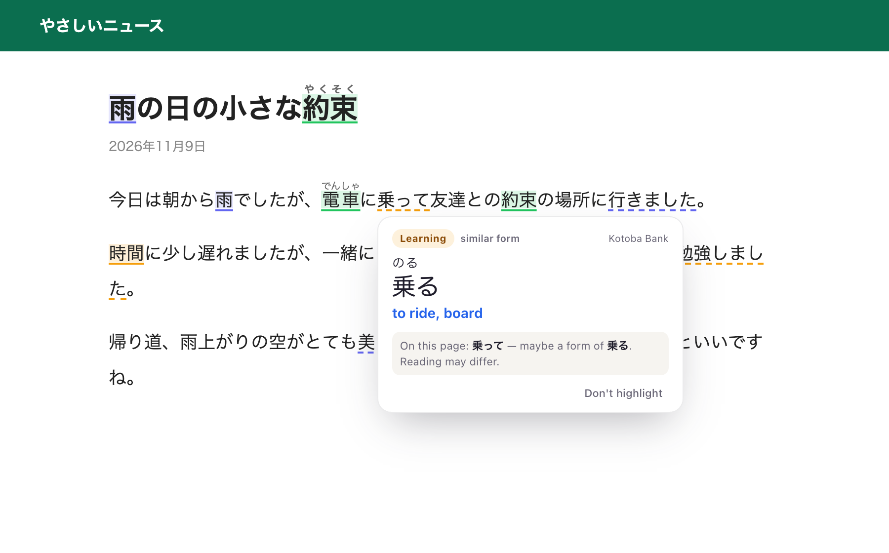
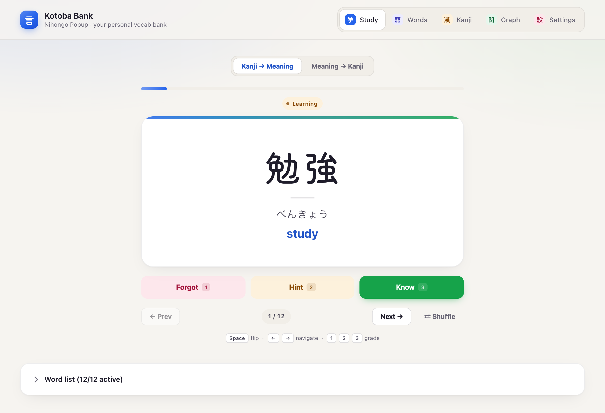
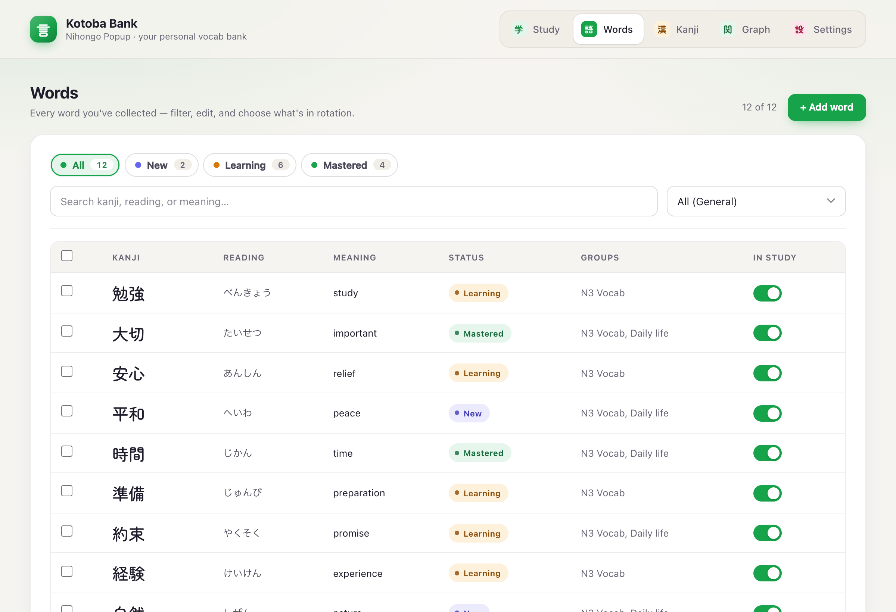
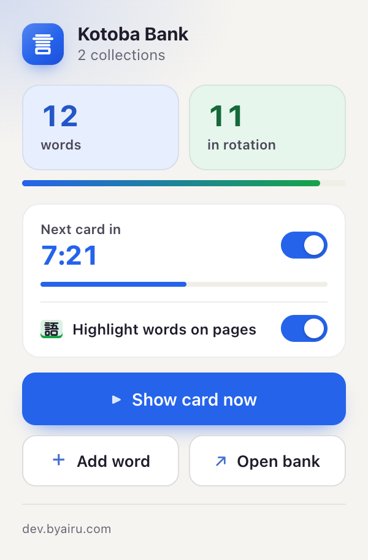

# Kotoba Bank

### Learn Japanese while you browse.

You study a word, close the app, and three days later it's gone. Then you're reading a Japanese
site and can't tell which words you've already learned.

**Kotoba Bank fixes both.** Your vocabulary follows you around the web: flashcards pop up while you
browse, and every word you've saved is highlighted on any Japanese page you open. No extra app to
remember to open. Your reviews happen while you browse.

  <a href="https://github.com/Rzkykhrllh/flashcard-popup/releases/latest"><b>⬇ Download for Chrome</b></a>
  &nbsp;·&nbsp;
  <a href="https://rzkykhrllh.github.io/flashcard-popup/">Website</a>

Free &amp; open source · No account · Your words never leave your browser

---

## Two ways it keeps your words alive

### 1. Flashcards that pop up while you browse
Every few minutes, a card slides in on whatever page you're on: news, YouTube, your inbox. A kanji
appears, you try to recall it, reveal, grade yourself. Five seconds, and you're back to what you were
doing.

- Words you keep forgetting come back more often. Words you know come back less.
- Classic (reveal → Know / Forgot) or Tiered mode (with a reading hint first).
- Snooze it, drag it anywhere, tap a kanji to see its readings without leaving the page.

### 2. Your vocabulary, highlighted on every Japanese page
Open any Japanese website and the words already in your bank are underlined, coloured by how well
you know them. Reading real Japanese stops being a wall of text: you instantly see what you've
learned, and every time you spot a word in the wild it sticks a little better.

- **New**, **Learning**, **Mastered**, each with its own colour.
- Conjugated forms are recognised too: 食べた and 行った link back to 食べる and 行く.
- Hover a word for its reading and *your* meaning, instantly.
- Works on furigana sites like NHK News Easy. Never changes the page itself.

## Everything else you need

- **One bank for every word**: kanji, reading, meaning, example sentence, notes. Group words into
  collections; each word tracks its own progress.
- **A focused Study tab** for proper sessions: Kanji → Meaning *and* Meaning → Kanji, keyboard-first
  (`Space` · `1` `2` `3` · `←` `→`), undo, pause, session results.
- **Quick-add from the toolbar**: save a word in seconds without leaving the page.
- **Kanji tab and graph**: every kanji across your words with on'yomi / kun'yomi and your own notes.
- **Light, dark or system**, four accent colours.

| Study | Words | Toolbar |
|---|---|---|
|  |  |  |

## Install in a minute

Kotoba Bank isn't on the Chrome Web Store yet, so it installs as an unpacked extension:

1. Download `kotoba-bank-vX.Y.Z.zip` from the [latest release](https://github.com/Rzkykhrllh/flashcard-popup/releases/latest) and unzip it somewhere permanent.
2. Open `chrome://extensions` and turn on **Developer mode** (top right).
3. Click **Load unpacked** and choose the unzipped folder.
4. Pin the extension, click it, choose **Open bank**, and add your first words.

**Updating:** download the new zip, replace the folder, press ↻ on the extension card. Your words are
kept, because they live in the browser, not in the folder. (Export a backup first anyway.)

## Your words stay yours

No account, no server, no analytics. Words, progress and settings are stored only in your browser.
The extension reads page text **locally** to show flashcards and highlights; it never sends it
anywhere. Back up any time with Export JSON. Full [privacy policy](https://rzkykhrllh.github.io/flashcard-popup/privacy.html).

## Credits & license

- Code: [MIT](LICENSE).
- Kanji readings: [KANJIDIC2](https://www.edrdg.org/wiki/index.php/KANJIDIC_Project) by the
  Electronic Dictionary Research and Development Group, used under
  [CC BY-SA 4.0](https://www.edrdg.org/edrdg/licence.html).
- Font: Zen Maru Gothic (SIL OFL 1.1). CSV parsing: Papa Parse (MIT).

Made by [dev.byairu.com](https://dev.byairu.com).
